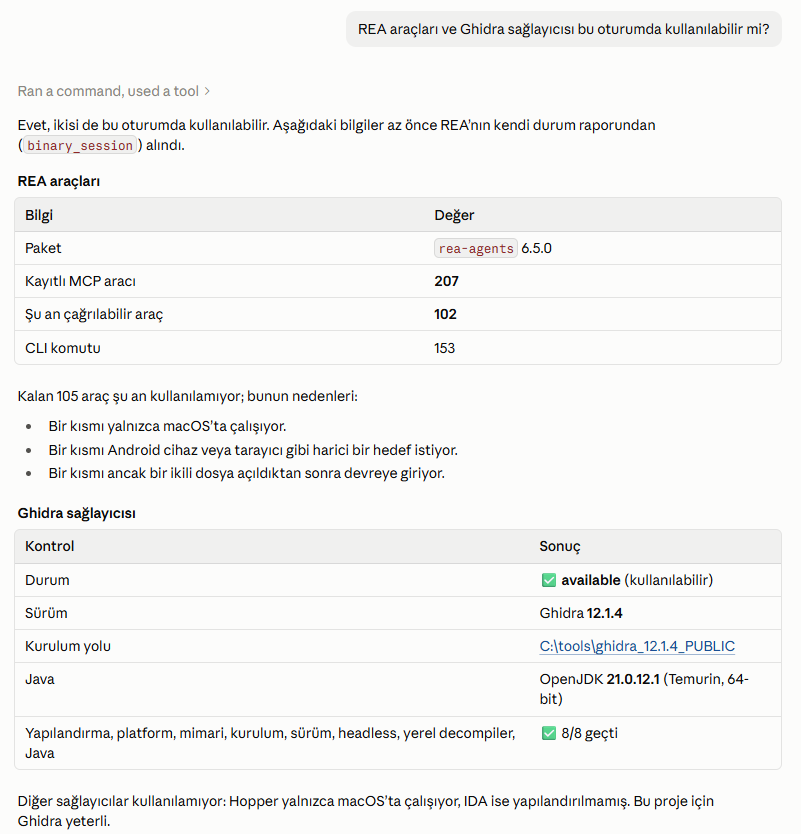

# YZM301 Teardown Sprint · χ² Olumsallık Tablosu (Konu 4)

> **Yapılan katmanlar:** Temel katman (CLI) — _devam ediyor_
> MCP sunucusu: ☐ · AI ajanı: ☐

G\*Power 3.1.9.7'nin **χ² testi, olumsallık tablosu** hesabının temiz oda yöntemiyle yeniden yazımı.
Bu araç G\*Power değildir ve G\*Power ekibiyle bir bağı yoktur (bkz. [Atıf](#atıf)).

Çalışma: bireysel.

## Hedef binary

| Alan | Değer |
|---|---|
| Ürün | G\*Power 3.1.9.7 (Windows) |
| Kaynak | Resmi sayfa: https://www.psychologie.hhu.de/arbeitsgruppen/allgemeine-psychologie-und-arbeitspsychologie/gpower |
| Dağıtım dosyası | `GPowerWin_3.1.9.7.zip` — SHA-256 `3BB7F1F2478D74EE5BA701AE7F849373CF2B8A11F6B6216C7C6B236DB7861199` |
| İncelenen çalıştırılabilir | `GPowerNT.exe` (FileVersion 3.1.9.7) |
| `GPowerNT.exe` SHA-256 | `C63E6A133EB6372932F810C08CC33DC35A06D1DDB658F897BD6C34A754EFC812` |

> Not: Ödev metni dosyayı "GPower.exe" diye anıyor; 3.1.9.7 Windows dağıtımında çalıştırılabilir dosyanın adı `GPowerNT.exe`.
> Binary bu repoda yer almaz (`.gitignore`).

## Kurulum kontrolü

<!-- TODO: Ajana "REA araçları ve Ghidra sağlayıcısı bu oturumda kullanılabilir mi?" sorusunun cevabının ekran görüntüsü -->


| Araç | Sürüm |
|---|---|
| REA (`rea-agents`) | _TODO_ |
| Ghidra | _TODO_ |
| JDK | 21 — _TODO_ |
| Ajan | Claude Code (Opus 5.5) |

## Kapsam: χ² olumsallık tablosu

G\*Power'da: **Test family → χ² tests**, **Statistical test → Goodness-of-fit tests: Contingency tables**.

| Mod | Girdiler | Çıktılar |
|---|---|---|
| A priori (N hesapla) | w, α, güç, df | λ, kritik χ², df, toplam N, gerçek güç |
| Post hoc (güç hesapla) | w, α, toplam N, df | λ, kritik χ², df, gerçek güç |

## Çalıştırma

_TODO — CLI sözleşmesi CONTRACT.md'den gelince._

```bash
gpower-clone --test chi2-contingency --mode a-priori ...
```

## Repo yapısı

| Yol | İçerik |
|---|---|
| `SPEC.md` | Kanıttan çıkarılmış spec, Gherkin kabul kriterleri |
| `LEDGER.md` | Kanıt defteri (`[DOK]` / `[REA]` / `[AJAN]`) |
| `HALLUCINATIONS.md` | Ajanın yanlış çıkardıkları ve onları yakalayan testler |
| `AGENT_COST.md` | Ajan maliyet ve süreç günlüğü |
| `prompts/` | İnceleme (Oturum 1) ve yazım (Oturum 2) oturumlarının ilk prompt'ları |
| `oracle/` | G\*Power'dan toplanan vektörler (CSV) ve ekran görüntüleri |
| `src/` | Motor + CLI |
| `tests/` | Diferansiyel test ve uyum raporu |

## Demo

_TODO: 60 saniyelik CLI videosu bağlantısı_

## Atıf

G\*Power, Franz Faul, Edgar Erdfelder, Albert-Georg Lang ve Axel Buchner tarafından geliştirilmiştir:

- Faul, F., Erdfelder, E., Lang, A.-G., & Buchner, A. (2007). G\*Power 3: A flexible statistical power analysis program for the social, behavioral, and biomedical sciences. *Behavior Research Methods, 39*, 175–191.
- Faul, F., Erdfelder, E., Buchner, A., & Lang, A.-G. (2009). Statistical power analyses using G\*Power 3.1: Tests for correlation and regression analyses. *Behavior Research Methods, 41*, 1149–1160.

Bu çalışma YZM301 dersi kapsamında, eğitim amacıyla yapılmıştır.
